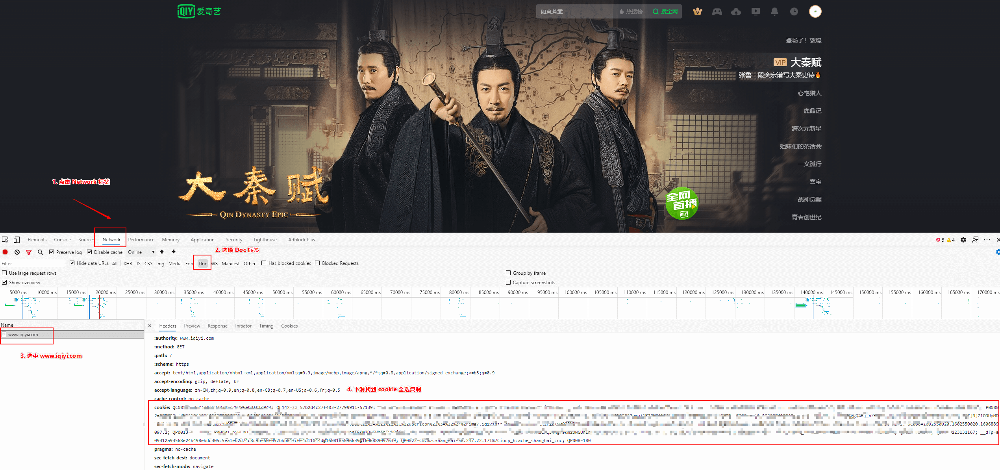

import { Steps } from 'nextra/components'
import CardList from '../../components/CardList'

<CardList />

# Microsoft Rewards

用登录后的 Cookie 领取 [Microsoft Rewards](https://rewards.bing.com/) 积分。一次运行会依次做这些事，并在结果里写明可用积分：

- **每日活动**：当天的 3 个每日活动。日期晚于今天的每日活动会跳过
- **更多活动**：积分大于 0 的活动，例如搜索、问答和拼图。中文和英文页面都会看一遍。0 积分的推荐任务会跳过
- **电脑搜索**：把必应搜索额度搜满，例如 30 分。搜索词来自百度实时热搜，两次搜索之间会停几秒
- **Edge 阅读**：凑满当天 30 分钟。大约每 5 分钟上报一次，这一轮大约要 25 分钟
- **移动签到**：必应应用每日签到，一次请求

只填写网页 Cookie 时，每日活动和更多活动可以完成。Edge 阅读和移动签到还要应用访问令牌；没有令牌时，这两项会在结果里单独写明，不影响前面已经领到的积分。

### 配置示例

```json filename="config.json" copy
{
  "BING": [
    {
      "cookie": "xxxxxx",
      "code": "",
      "refresh_token": "",
      "proxy": ""
    },
    {
      "cookie": "多账号 cookie 填写，请参考上面，cookie 以实际获取为准（遇到特殊字符如双引号\" 请加反斜杠转义）",
      "code": "",
      "refresh_token": "",
      "proxy": ""
    }
  ]
}
```

### 配置说明

|           参数           |                     说明                     |
| :----------------------: | :------------------------------------------: |
| _**BING**_.cookie        | 登录 [rewards.bing.com](https://rewards.bing.com/) 后复制的整段 Cookie |
| _**BING**_.code          | 可选，一次性。下面授权页跳转后地址栏里的 `code`，脚本会换成 `refresh_token` 并删掉它 |
| _**BING**_.refresh_token | 可选。Edge 阅读和移动签到用的应用刷新令牌，换成功后会自动写入 |
| _**BING**_.proxy         | 可选。例: `http://127.0.0.1:1080`，不需要代理就留空 |

## 获取方式

> 参考「爱奇艺」获取方式



<Steps>

### 打开官网

进入 [Microsoft Rewards](https://rewards.bing.com/) 并登录

### 打开开发者工具

按 `F12` 打开开发者工具，刷新页面

### 点击 Network 标签

### 选择 Doc 标签

### 选中 rewards.bing.com

### 下滑找到 cookie 全选复制即可

复制请求头里的整段 Cookie，填进 `cookie`。只做每日活动和更多活动时，到这一步就可以。

### 获取 Edge 阅读和移动签到的授权码

用同一个微软账号登录浏览器，打开这个地址：

`https://login.live.com/oauth20_authorize.srf?client_id=0000000040170455&response_type=code&scope=service::prod.rewardsplatform.microsoft.com::MBI_SSL&redirect_uri=https://login.live.com/oauth20_desktop.srf&state=rewards`

跳转后的页面可以是空白或报错。把地址栏整段填进 `code`，马上执行一次。授权码大约几分钟就失效。脚本会把它换成 `refresh_token` 写回配置，并删掉 `code`。之后每次运行沿用 `cookie` 和 `refresh_token` 即可。

移动签到是一次请求。Edge 阅读大约每 5 分钟上报一次，凑满 30 分钟，这一轮大约持续 25 分钟。

</Steps>
